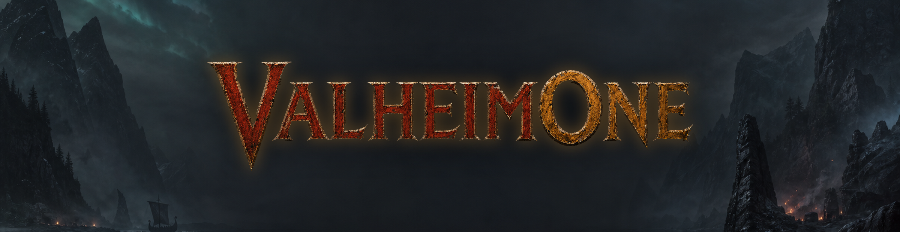
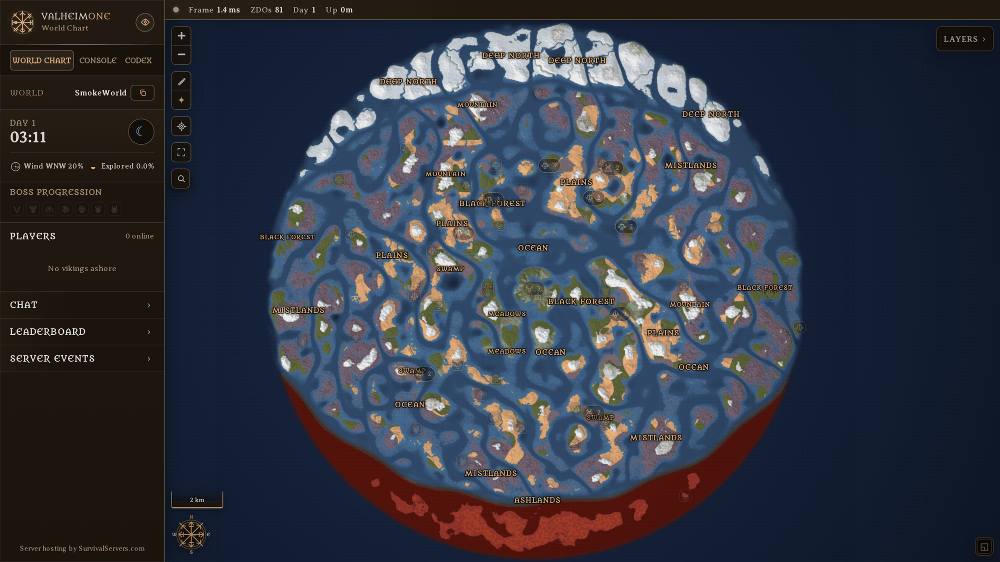
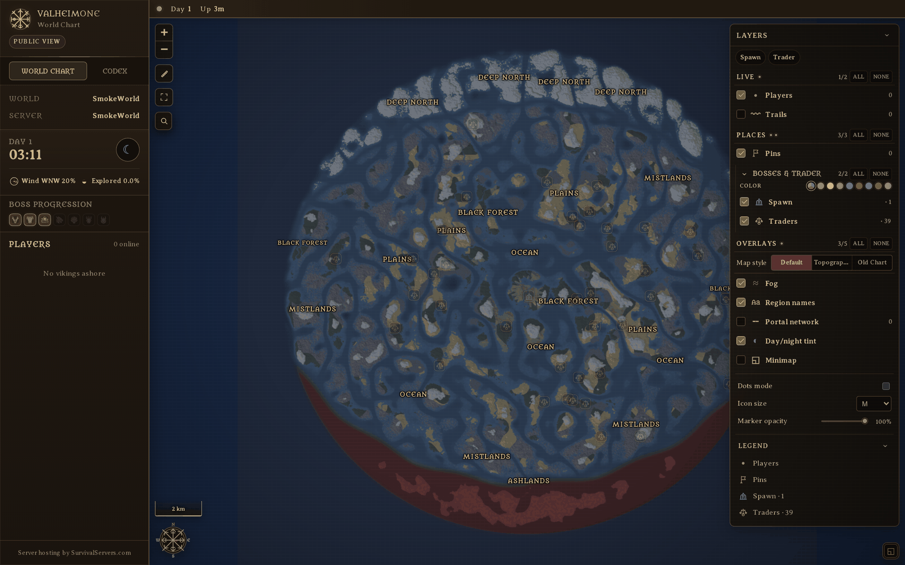
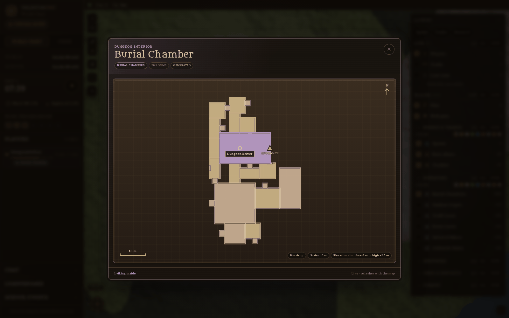
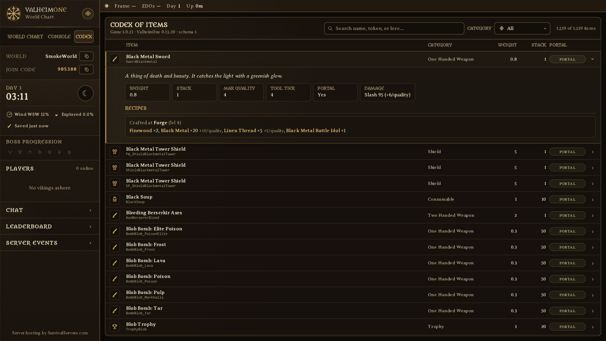
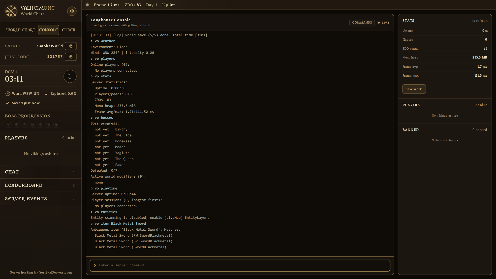

<p align="center">
  
</p>

<p align="center">
  <a href="LICENSE"></a>
  <a href="https://github.com/BepInEx/BepInEx"></a>
  <a href="https://store.steampowered.com/app/892970/"></a>
  <a href="#features"></a>
</p>

# ValheimOne

A Valheim dedicated server has no map, no browser console and no alerts of its own, and it stops at 10 players. ValheimOne adds them: a live web map you can share with your players, an admin console in your browser, an item and recipe search, Discord alerts, a higher player limit and optional gameplay settings. It's one BepInEx mod on the server. Your players can join with an unmodded game, on PC or console.

_ValheimOne is a community project and is not affiliated with or endorsed by Iron Gate Studio._

## Contents

- [Features](#features)
- [Install](#install)
- [Settings](#settings)
- [Commands](#commands)
- [Verifying the binary](#verifying-the-binary)
- [Getting help](#getting-help)
- [Contributing](#contributing)
- [License](#license)
- [Credits](#credits)

---

## Features

### 🗺️ Live map

The map draws the whole world from the server seed and updates in real time. Players, ships, carts, portals, tombstones, wards and beds all show on it. Fog of war follows where players have walked and what they shared through cartography tables.



Turn on the heatmap to see where everyone has been over the last day or week, open the timelapse to scrub through explored fog and base growth, or open the Sagas leaderboard for playtime, deaths and distance travelled.

### 🔗 Share the map with your players

There are three views. **Admin** sees everything. **Shared** shows live players and the layers you allow, with no admin actions. **Public** is a read-only link with its own fog and layer settings. Fog can be a light tint or a solid cover that hides everything nobody has explored yet, including region names and markers, and Public viewers can't switch the cover off. The settings are under [Fog and Shared map layers](#fog-and-shared-map-layers).



### 🏛️ Dungeon maps

Click any dungeon entrance for a top-down map of its rooms, with live players drawn inside it.



### 📖 Item and recipe search

Search and filter every item and recipe: weight, stack size, tiers, damage, armour, full recipes with station requirements, what drops it and what it's used to make. Jump from an ingredient to everything that needs it.



### 💻 Server console in your browser

Watch the server log live and type commands with history and autocomplete. Kick, ban, save the world, or schedule a shutdown that warns players first.



<a id="less-lag"></a>

### 📶 Less lag when you play together

When several players play close together, the server runs out of room for world updates, and players and creatures rubber-band until the group splits up. ValheimOne raises that limit from 10 KB to 32 KB per player, on Steam and crossplay, and lets Steam send up to 1 MB/s per player instead of 150 KB/s. It runs on the server only, so players on the normal game and on console get it too.

<picture>
  <source media="(prefers-color-scheme: dark)" srcset="docs/screenshots/send-limit-lab-dark.png">
  
</picture>

Measured on a test server with four test players, 150 seconds per run. Valheim sends each moving thing at most about 6 times a second, so a quiet group gains little. A busy group gets back close to that.

It's on by default. Set `Enabled = false` in `[Network]` to go back to Valheim's own limit. It turns itself off, with one line in the log, when Better Networking or another mod that changes the same limit is installed.

### Also built in

- **Up to 127 players.** Set `MaxPlayers` in `[Server]`. It works on Steam and crossplay, and players install nothing. On crossplay the new limit applies at the next start.
- **Gameplay settings.** 26 optional modules for carry weight, stamina, food, drops, gathering, build rules, portals, taming, raids, production speeds and more. All are off until you turn them on, and most values apply without a restart. Modules marked Synced also need ValheimOne on each player's PC. [Every module and what it needs](docs/gameplay-modules.md).
- **Discord alerts.** Joins, leaves, deaths with the biome they died in, raids starting and ending, world saves and new days. Point it at a webhook and pick the events you want.
- **Shows up in server lists.** Server browsers, monitoring tools and hosting panels can see the server, crossplay servers included. Player and server details are also at `/api/status` and `/api/players` ([reference](docs/query.md)).

---

## Install

The [Steam setup guide](https://steamcommunity.com/sharedfiles/filedetails/?id=3802119003) walks through installation, private map access, sharing and browser commands.

### Rent a server

[SurvivalServers.com](https://www.survivalservers.com/services/game_servers/valheim/?utm_source=github&utm_medium=readme&utm_campaign=valheim_one) runs Valheim servers with ValheimOne installed.

### Install on your server

You need a Valheim dedicated server with the [BepInEx pack for Valheim](https://thunderstore.io/c/valheim/p/denikson/BepInExPack_Valheim/).

1. Download the current [GitHub release](https://github.com/HumanGenome/ValheimOne/releases/latest). Use the plugin-only ZIP if BepInEx is installed, or the full ZIP for a fresh setup.
2. Stop the server and extract the ZIP into its main folder, so the mod sits at `BepInEx/plugins/ValheimOne.dll`. When you update, keep your own `BepInEx/config/valheimone.cfg`. On Linux, start the server with the full ZIP's `start_server_bepinex.sh` and your usual server arguments.
3. Start the server once so it writes the config file, then stop it. In the `[LiveMap]` section of `BepInEx/config/valheimone.cfg`, set `Enabled = true`, pick a long `AccessToken` of your own, and set `PublicView = false` for now. The live map is off until you do this.
4. Start the server and wait for the world to load. On your own network, open `http://your-server-ip:8790/?token=YOUR_ADMIN_TOKEN` with your own IP and token (the map uses TCP port `8790`). Over the internet, put it behind an HTTPS reverse proxy. Behind a proxy, set `RelayKey` in `[LiveMap]` to a long random value and have the proxy send it in an `X-Relay-Key` header. The map then answers only requests that carry it, or that come from the server itself.
5. To type commands in the browser, set `ConsoleEnabled = true` in `[LiveMap]`. To show ships, carts and portals, set `EntityLayer = true`. To share the map, set a separate `ShareToken` or turn on `PublicView` (a link with no token), then pick the fog and public layers. Keep your admin token to yourself.

```text
Valheim Dedicated Server/
└── BepInEx/
    ├── config/valheimone.cfg
    └── plugins/ValheimOne.dll
```

<a id="install-on-your-pc"></a>

### Install on players' PCs

You can join a ValheimOne server with an unmodded game, on PC or console. The live map, the browser console, the alerts and the raid settings in World Events work with nothing installed on your side.

The other gameplay modules are applied by the player's own game, so they only work on a PC that also has ValheimOne. That includes Drops, Gathering and the guardian power settings in World Events. Loot is rolled on the PC of the player standing nearby, so a player without ValheimOne gets normal drops. Console players can't install mods.

1. Close Valheim. Open the [latest release](https://github.com/HumanGenome/ValheimOne/releases/latest) and download `ValheimOne-full-<version>.zip` under **Assets**. The green Code button gives you the source, not the mod.
2. In Steam, right click Valheim, then Manage, then Browse local files. Extract the ZIP into that folder so `winhttp.dll` and `BepInEx/` sit next to `valheim.exe`.
3. Start Valheim from Steam. A BepInEx console window opens next to the game. Join the server: it sends its settings to your game, and your own config file stays as it is.

```text
Valheim/
├── BepInEx/
│   ├── config/valheimone.cfg
│   └── plugins/ValheimOne.dll
├── doorstop_config.ini
├── winhttp.dll
└── valheim.exe
```

- **Already running BepInEx:** use the plugin-only ZIP instead. It holds only `BepInEx/plugins/ValheimOne.dll`.
- **Mod manager profile:** install [ValheimOne from Thunderstore](https://thunderstore.io/c/valheim/p/HumanGenome/ValheimOne/) in r2modman or Thunderstore Mod Manager and start the game from the manager. If its search doesn't show it yet, use Import local mod with the plugin-only ZIP. A profile and the game folder are separate installs.
- **Linux and Steam Deck:** set the Steam launch option `./start_game_bepinex.sh %command%`.
- **Check it:** `BepInEx/LogOutput.log` shows `Sent VO_Hello to server` and `Server config applied` after you join. The server log shows `is modded: handshake ok` or `is vanilla: no VO_Hello received within 15s` for each player.
- **Versions:** keep the server and every PC on the same minor version, 0.13.x with 0.13.x. After a Valheim patch, check the releases page before you play.
- **Enforce Mod:** `EnforceMod = true` in `[Server]` kicks players on the normal game and on console. Leave it `false` on a mixed or crossplay server.
- **Remove it:** delete `BepInEx/plugins/ValheimOne.dll` and `BepInEx/config/valheimone.cfg`. To turn every mod off, rename `winhttp.dll`.

To build from source, run `./build.sh`. [RELEASING.md](RELEASING.md) covers packaging.

---

## Settings

Everything lives in one file: `BepInEx/config/valheimone.cfg`. Start the server once to generate it, then turn on the sections you want. Saving the file applies most changes live, without a restart. Keep your file when you update.

| Section | What it does | Default |
|---|---|---|
| `[LiveMap]` | The map, console, sharing and fog | Off |
| `[Network]` | The higher [send limit](#less-lag) | On |
| `[Server]` | Player limit, Enforce Mod, settings sent to players | On, with Valheim's limit of 10 |
| `[ActivityLog]` | Player activity for the map's Sagas panel, kept 30 days | On |
| `[Discord]` | Discord alerts | Off |
| `[Query]` | Shows up in server lists ([reference](docs/query.md)) | Off |
| 26 gameplay sections | [Each module and what it needs](docs/gameplay-modules.md) | Off |

```ini
[Player]

Enabled = true
BaseMaximumWeight = 450
MegingjordBuff = 200
```

<a id="fog-and-shared-map-layers"></a>

### Fog and Shared map layers

All of these live in `[LiveMap]`. Set `FogMode = trails` or `explored` to record the fog you want to display. The default fog is a translucent tint over the full terrain.

`FogHideUnexplored = true` gives the Public view a solid cover and hides unexplored region names and spawn and trader markers. Public viewers can't turn it off. Check the public link before you share it.

`SharedFog = true` gives Shared viewers the same locked cover while keeping chat and stats. It defaults to false.

`SharedPoiGroups = all` keeps every point-of-interest layer in the Shared view. Use `none` to hide them, or a space-separated list such as `spawn trader` to show only those groups. The [group keys](docs/query.md#shared-point-of-interest-groups) are in the API reference.

Admins can switch on **Fog preview** under Layers to keep unexplored areas covered on their own map. It starts off, also hides unexplored markers and region names, and doesn't change admin permissions. It needs `FogMode` set.

Fog only changes what the map draws: someone with the link can still load the terrain images under it.

### New world with a chosen seed

`NewWorldSeed = <seed>` in `[Server]` (1 to 10 letters or digits) makes a dedicated server create the world named by `-world` with that seed, when that world doesn't exist yet. After the start the setting is cleared and the log says what happened. A world that already exists is never changed: the setting is ignored, cleared and logged.

### World summary beside the save

After each world save, a dedicated server writes `<world>.valheimone.json` next to the world in `worlds_local`: the world and seed names, the day, the bosses defeated, the players since the last save, the save time and the ValheimOne and game versions. The fields are in [docs/query.md](docs/query.md#world-save-summary).

---

## Commands

Type these in the browser console. `vo help` lists them all and `vo help <command>` explains one.

| Command | What it does |
|---|---|
| `vo players` | Connected players, session times and IDs |
| `vo save` | Save the world and connected player profiles |
| `vo shutdown 60 Restarting` | Shut down after a save and a warning, `vo shutdown cancel` to stop it |
| `vo kick <player>`, `vo ban <player>`, `vo unban <id>` | Remove or ban a player by name or ID |
| `vo item <name>` | Recipes, sources and drops for an item |
| `vo doctor` | Plugin, module, settings and map health |

---

## Verifying the binary

Every release can be rebuilt byte for byte from its tag. The steps are in [docs/verifying.md](docs/verifying.md).

---

## Getting help

Bugs and feature requests go to [GitHub Issues](https://github.com/HumanGenome/ValheimOne/issues). Questions about a server you rent go to your host.

---

## Contributing

See [CONTRIBUTING.md](CONTRIBUTING.md).

---

## License

MIT. See [LICENSE](LICENSE).

---

## Credits

[BepInEx](https://github.com/BepInEx/BepInEx) and [Harmony](https://github.com/pardeike/Harmony) load and patch the mod. The map draws with [Leaflet](https://leafletjs.com). The higher send limit takes its idea from [Better Networking](https://github.com/CW-Jesse/valheim-betternetworking) by CW_Jesse (MIT); ValheimOne's code is its own. Fonts: Metamorphous and Averia Serif Libre (SIL Open Font License).
