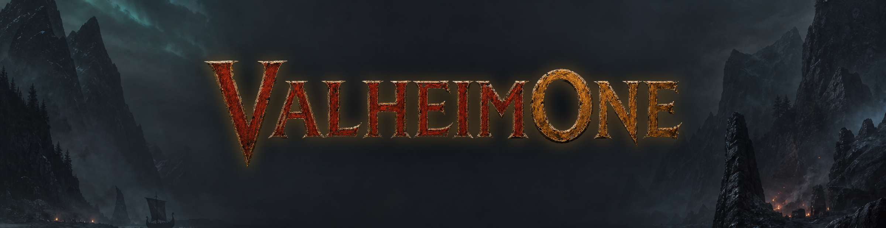
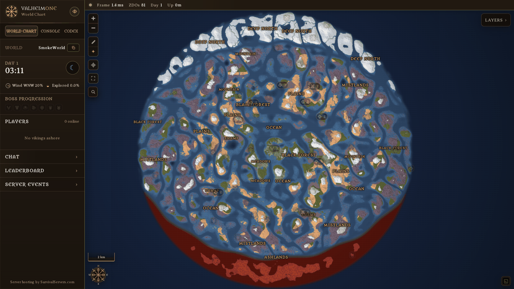
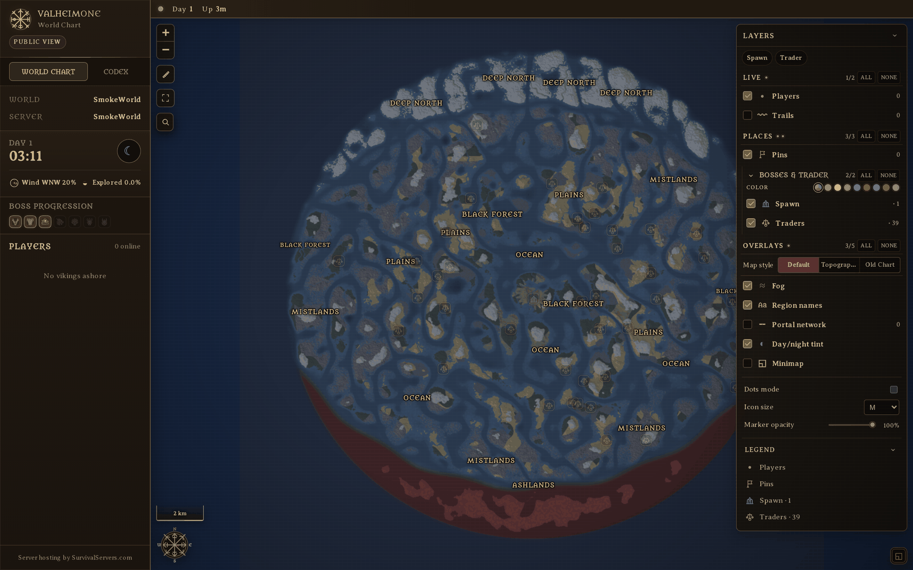
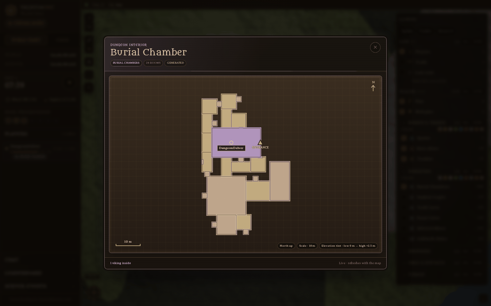
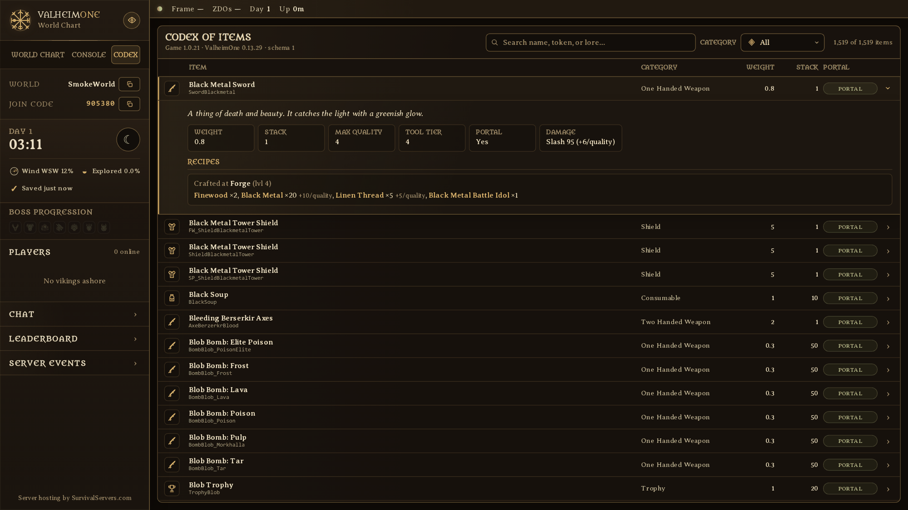
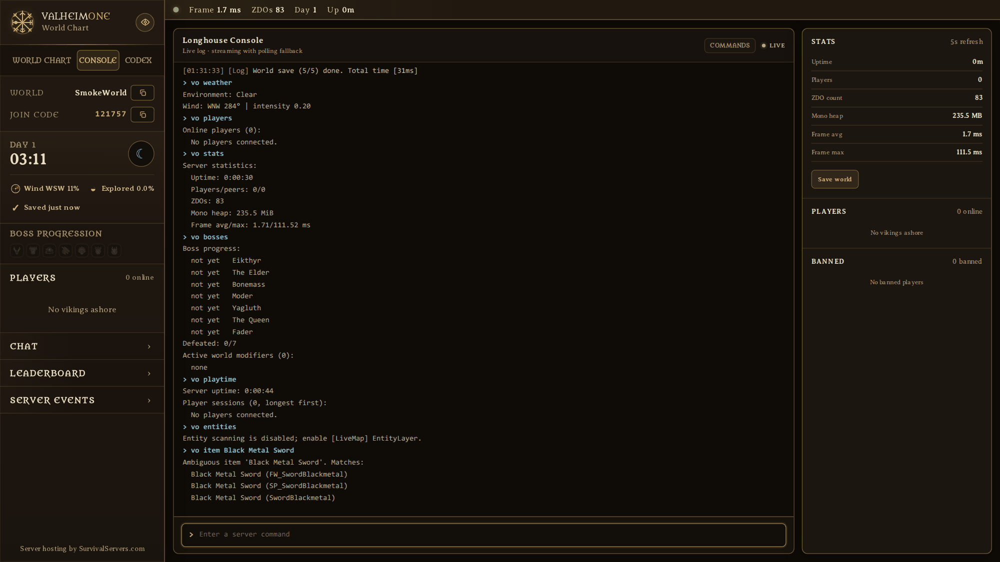

<p align="center">
  
</p>

<p align="center">
  <b>A live web map and browser admin console for Valheim dedicated servers.</b><br>
  Share the map with your players, search every item and recipe, get Discord alerts and turn on optional gameplay rules for your world.<br>
  The map and admin tools work with vanilla clients.
</p>

<p align="center">
  <a href="LICENSE"></a>
  <a href="https://github.com/BepInEx/BepInEx"></a>
  <a href="https://store.steampowered.com/app/892970/"></a>
  <a href="#features"></a>
</p>

<p align="center">
  <a href="#live-map"><b>Live Map</b></a> &nbsp;&bull;&nbsp;
  <a href="#sharing"><b>Sharing</b></a> &nbsp;&bull;&nbsp;
  <a href="#dungeons"><b>Dungeons</b></a> &nbsp;&bull;&nbsp;
  <a href="#codex"><b>Codex</b></a> &nbsp;&bull;&nbsp;
  <a href="#console"><b>Console</b></a> &nbsp;&bull;&nbsp;
  <a href="#install"><b>Install</b></a>
</p>

---

<a id="features"></a>

## Features

<a id="live-map"></a>

### 🗺️ Live World Map

Your whole world in a browser, drawn from the server seed and updating in real time. Players, ships, carts, portals, tombstones, wards and beds move as they happen. Fog-of-war follows recorded player trails and exploration shared through cartography tables.



Turn on the heatmap to see where everyone has been over the last day or week, open World Timelapse to scrub through explored fog, base growth and aggregate movement history, or view the Sagas leaderboard for playtime, deaths and distance travelled.

<a id="sharing"></a>

### 🔗 Share It With Your Players

Three views, and you decide who gets which. **Admin** sees everything. **Shared** shows live players and the layers you allow, with no admin actions. **Public** is a read-only link with its own fog and layer settings. Fog can be a light tint or a solid cover that hides everything nobody has explored yet, including region names and markers, and Public viewers cannot switch the cover off. The settings are under [Fog and Shared map layers](#fog-and-shared-map-layers).



<a id="dungeons"></a>

### 🏛️ Look Inside Dungeons

Click any dungeon entrance and get a top-down room schematic read straight from the game's own generated layout, with live players drawn inside it.



<a id="codex"></a>

### 📖 Codex of Items

Searchable, filterable items and recipes: weight, stack size, tiers, damage, armour, full recipes with station requirements, what drops it, and what it is used to make. Jump straight from an ingredient to everything that needs it.



<a id="console"></a>

### 💻 Admin Console In The Browser

A live server log and a command box with history and autocomplete, running whitelisted commands through the game's own console. Kick, ban, save the world, or schedule a graceful shutdown that warns players on the way down.



### ⚙️ Optional Gameplay Modules

Twenty-six opt-in modules covering carry weight, stamina, food, drops, gathering, build rules, portals, taming, raids, production speeds and more. Everything is off until you turn it on, and most values hot-reload without a restart.

Modules marked **Synced** need ValheimOne on each participating PC; the server then sends those players its settings. Console players cannot install those client mods. The live map, browser console and alerts do not require a client plugin. See [docs/gameplay-modules.md](docs/gameplay-modules.md) for each module's scope and [Install on your PC](#install-on-your-pc) for the player steps.

### 🔔 Discord Alerts

Joins, leaves, deaths with the biome they died in, raids starting and ending, world saves and new days. Point it at a webhook and pick which events you care about.

### 📡 Server Browser Support

A standalone A2S query responder so server browsers, monitoring tools and hosting panels can see your server, including crossplay servers that do not answer A2S on their own. Richer JSON lives at `/api/status` and `/api/players`.

See [docs/query.md](docs/query.md).

### 📶 Less Lag When You Play Together

Valheim lets the server have at most 10 KB of world updates on the way to each player, and serves one player per frame. When several players play close together, each one also needs everything the others change, the 10 KB runs out, and updates arrive in bursts: players and creatures rubber-band until the group splits up. ValheimOne raises that limit to 32 KB on Steam and crossplay alike, and lets Steam send up to 1 MB/s per player instead of a fixed 150 KB/s. It runs on the server only, so players install nothing and vanilla and console players get it too.

<picture>
  <source media="(prefers-color-scheme: dark)" srcset="docs/screenshots/send-limit-lab-dark.png">
  
</picture>

Measured on a lab server with four test players, 150 seconds per run. Valheim sends each moving thing at most about 6 times a second, so a quiet group gains little; a busy group gets back to near that ceiling.

It is on by default. Set `Enabled = false` in `[Network]` to go back to Valheim's own limit. It turns itself off, with one line in the log, when Better Networking or another mod that changes the same limit is installed.

---

<a id="install"></a>

## Installation

The [Steam setup guide](https://steamcommunity.com/sharedfiles/filedetails/?id=3802119003) walks through installation, private map access, sharing and browser commands.

### Install on your server

You need a Valheim Dedicated Server with the Valheim-compatible [BepInEx pack](https://thunderstore.io/c/valheim/p/denikson/BepInExPack_Valheim/).

1. Download the current [GitHub release](https://github.com/HumanGenome/ValheimOne/releases/latest). Use the plugin-only ZIP if BepInEx is installed, or the Full ZIP for a fresh setup.
2. Stop the server and extract the ZIP into its root folder. The plugin belongs at `BepInEx/plugins/ValheimOne.dll`. Preserve your existing `BepInEx/config/valheimone.cfg` when updating; do not replace it with the packaged defaults. On Linux, use the Full pack's `start_server_bepinex.sh` with your usual server arguments.
3. Start once to generate any missing config, then stop before the initial configuration. In the existing `[LiveMap]` section of `BepInEx/config/valheimone.cfg`, set `Enabled = true`, choose a long unique `AccessToken`, and set `PublicView = false` while configuring access. The live map is disabled by default.
4. Start the server and wait for the world to load. The default map port is TCP `8790`. On a trusted network, open `http://your-server-ip:8790/?token=YOUR_ADMIN_TOKEN` with your own values. Use an HTTPS reverse proxy for authenticated access over the Internet. Behind a proxy, set `RelayKey` in `[LiveMap]` to a long random value and have the proxy send it in an `X-Relay-Key` header: the map then refuses every request without it, except requests from the server machine itself.
5. Set `ConsoleEnabled = true` in `[LiveMap]` if you want browser commands. Set `EntityLayer = true` to collect the optional ships, carts and portals layer. For sharing, configure a separate `ShareToken` or enable the tokenless `PublicView`, then choose the fog and public layers. Keep your admin token private.

```text
Valheim Dedicated Server/
└── BepInEx/
    ├── config/valheimone.cfg
    └── plugins/ValheimOne.dll
```

> **Official Hosting:** ValheimOne is included with [Valheim server hosting from SurvivalServers](https://www.survivalservers.com/services/game_servers/valheim/?utm_source=github&utm_medium=readme&utm_campaign=valheim_one), with map and console controls in the control panel. You can also install the free mod on your own dedicated server using the steps above.

<a id="install-on-your-pc"></a>

### Install on your PC (players)

You can join a ValheimOne server with an unmodded game, on PC or console. The live map, the browser console, the alerts and the raid settings in World Events work with nothing installed on your side.

The other gameplay modules are applied by the player's own game, so they only work on a PC that also has ValheimOne. That includes Drops, Gathering and the guardian power settings in World Events. The game rolls the loot of a tree, rock or creature in the game of the player standing near it, so a player without ValheimOne gets normal drops. Consoles cannot install mods.

1. Close Valheim. Open the [latest release](https://github.com/HumanGenome/ValheimOne/releases/latest) and download `ValheimOne-full-<version>.zip` under **Assets**. The green Code button gives you the source, not the mod.
2. In Steam, right click Valheim, then Manage, then Browse local files. Extract the ZIP into that folder so `winhttp.dll` and `BepInEx/` sit next to `valheim.exe`.
3. Start Valheim from Steam. A BepInEx console window opens next to the game. Join the server. It sends its settings to your game at join, and your local config file is not changed.

```text
Valheim/
├── BepInEx/
│   ├── config/valheimone.cfg
│   └── plugins/ValheimOne.dll
├── doorstop_config.ini
├── winhttp.dll
└── valheim.exe
```

- **Already running BepInEx:** use the plugin-only ZIP instead. BepInEx alone changes nothing; the mod is `BepInEx/plugins/ValheimOne.dll`.
- **Mod manager profile:** if the manager's search does not list ValheimOne, use its Import local mod setting with the plugin-only ZIP and start the game from the manager. A profile and the game folder are separate installs.
- **Linux and Steam Deck:** set the Steam launch option `./start_game_bepinex.sh %command%`.
- **Check it:** `BepInEx/LogOutput.log` shows `Sent VO_Hello to server` and `Server config applied` after you join. The server log shows `is modded: handshake ok` or `is vanilla: no VO_Hello received within 15s` for each player.
- **Versions:** keep the server and every PC on the same minor version, 0.13.x with 0.13.x. After a Valheim patch, check the releases page before you play.
- **Enforce Mod:** `EnforceMod = true` in `[Server]` kicks vanilla and console players. Leave it `false` on a mixed or crossplay server.
- **Red error at launch:** 0.13.14 and older print `Failed to patch ... ZPlayFabMatchmaking::CreateLobby` on a player's PC. It is harmless, and 0.13.15 removes it.
- **Remove it:** delete `BepInEx/plugins/ValheimOne.dll` and `BepInEx/config/valheimone.cfg`. To turn every mod off, rename `winhttp.dll`.

Building from source is `./build.sh`; see [RELEASING.md](RELEASING.md) for packaging.

---

## Configuration

Everything lives in one file: `BepInEx/config/valheimone.cfg`. Every gameplay section is off by default, so a fresh install changes no gameplay until you opt in. The [send limit](#-less-lag-when-you-play-together) in `[Network]` is on by default.

Start the server once to generate the file, then enable the sections you want:

```ini
[Player]

Enabled = true
BaseMaximumWeight = 450
MegingjordBuff = 200
```

Saving the file applies most changes live, without a restart. Preserve your existing file when you update.

- Full module list and what each one does: [docs/gameplay-modules.md](docs/gameplay-modules.md)
- Query and status endpoints: [docs/query.md](docs/query.md)

<a id="fog-and-shared-map-layers"></a>

### Fog and Shared map layers

All of these live in `[LiveMap]`. Set `FogMode = trails` or `explored` to record the fog you want to display. The default fog is a translucent tint over the full terrain.

`FogHideUnexplored = true` gives the Public view a solid cover and withholds unexplored region names and spawn and trader markers. Public viewers cannot turn it off. Check the tokenless link before you share it.

`SharedFog = true` gives Shared viewers the same locked cover while keeping chat and stats. It defaults to false.

`SharedPoiGroups = all` keeps every point-of-interest layer in the Shared view. Use `none` to hide them, or a space-separated list such as `spawn trader` to show only those groups. The [group keys](docs/query.md#shared-point-of-interest-groups) are in the API reference.

Admins can switch on **Fog preview** under Layers to keep unexplored areas covered on their own map. It starts off, also hides unexplored markers and region names, and does not change admin permissions. It needs `FogMode` set.

Fog changes what the map draws. It does not restrict access to the underlying terrain images.

---

## Verifying the binary

A byte-for-byte reproduction requires a Git clone checked out at the exact release tag, the .NET SDK pinned in `global.json`, and a clean working tree. The compile is deterministic and embeds no commit SHA or build-host paths, so identical sources and toolchain produce an identical DLL.

```bash
git clone https://github.com/HumanGenome/ValheimOne.git
cd ValheimOne
git checkout --detach v<version>
curl -sSL https://dot.net/v1/dotnet-install.sh | bash -s -- --version 10.0.302 --install-dir "$HOME/.dotnet"
export PATH="$HOME/.dotnet:$PATH" DOTNET_ROOT="$HOME/.dotnet"
tools/verify-reproducible.sh --release v<version>
```

The verifier clean-builds the DLL and checks it against both the checked-in release provenance and the DLL inside the GitHub release asset.

```text
building HEAD commit: <40-hex commit>
verified: clean build ValheimOne.dll <sha256>
verified: published v<version> plugin zip ValheimOne.dll <sha256>
REPRODUCIBLE <version>
```

The Thunderstore package is the same source built with `-p:ValheimOneHostingCredit=false`, which leaves the link in the map sidebar's footer out. At the release tag, `tools/package-thunderstore.sh` rebuilds that DLL and archive and checks both against `tools/release/thunderstore-provenance.tsv`.

---

## Getting Help

Bugs and feature requests go to [GitHub Issues](https://github.com/HumanGenome/ValheimOne/issues). If you rent your server, hosting and control-panel questions belong with your provider.

---

## Contributing

See [CONTRIBUTING.md](CONTRIBUTING.md).

If ValheimOne helps your group, a GitHub star is appreciated.

---

## License

MIT. See [LICENSE](LICENSE).

---

_ValheimOne is a community project and is not affiliated with or endorsed by Iron Gate Studio._
